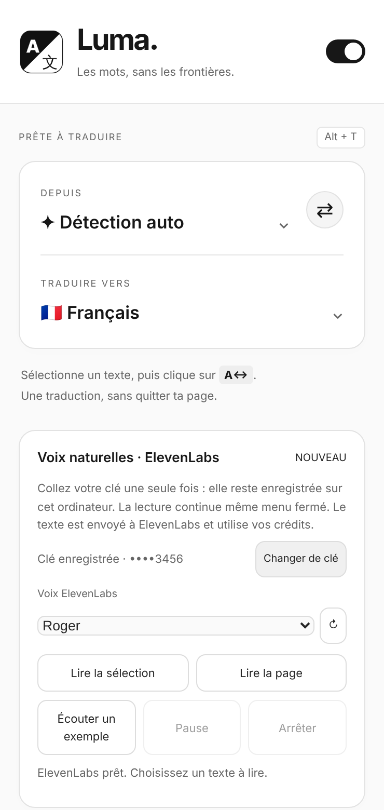

<h1 align="center">Luma</h1>

<b>Les mots, sans les frontières.</b> 
Traduction au clic et voix naturelles ElevenLabs, directement dans Chrome.

<a href="https://github.com/Zakir310/Luma-translate-/raw/refs/heads/main/livraison/Luma.zip"><b>⬇ Télécharger Luma 1.6.0</b></a>

---

## Fonctionnalités

| | |
|---|---|
| **Traduire une sélection** | Surlignez un texte sur n'importe quelle page, cliquez sur la bulle **A↔** ou appuyez sur **Alt+T**. |
| **Traduire toute la page** | Un clic dans le menu traduit la page entière ; « Afficher l'original » la remet comme avant. |
| **Voix naturelles ElevenLabs** | Écoutez la sélection ou toute la page avec une voix réaliste. La lecture **continue même menu fermé**. |
| **Voix de l'ordinateur** | Option gratuite, hors ligne, avec les voix installées sur votre ordinateur. |
| **Historique** | Les 3 dernières traductions, effaçables à tout moment. |

---

## 1. Installer Luma dans Chrome

1. [Téléchargez **Luma.zip**](https://github.com/Zakir310/Luma-translate-/raw/refs/heads/main/livraison/Luma.zip) et décompressez-le
   (Mac : double-clic · Windows : clic droit → **Extraire tout**).
2. Dans Chrome, ouvrez `chrome://extensions` et activez **Mode développeur** (en haut à droite).
3. Cliquez sur **Charger l'extension non empaquetée** et choisissez le dossier **`Luma`**
   (celui qui contient `manifest.json`).
4. Épinglez Luma : icône puzzle 🧩 de Chrome → punaise 📌 à côté de Luma.
5. Rechargez les pages déjà ouvertes (**Cmd+R** / **F5**).

La traduction fonctionne immédiatement, sans compte ni clé.

## 2. Obtenir votre clé API ElevenLabs (pour les voix)

Les voix naturelles viennent d'[ElevenLabs](https://elevenlabs.io). Il vous faut **votre propre clé API** :
elle n'est pas fournie avec Luma.

1. Créez un compte gratuit sur **[elevenlabs.io](https://elevenlabs.io)** (ou connectez-vous).
2. Ouvrez **[elevenlabs.io/app/settings/api-keys](https://elevenlabs.io/app/settings/api-keys)**
   (menu de votre profil → **API Keys**).
3. Cliquez sur **Create API Key** et donnez-lui un nom, par exemple `Luma`.
4. Dans les permissions, activez au minimum :
   - **Text to Speech** → *Access*
   - **Voices** → *Read*
5. Cliquez sur **Create**, puis **copiez la clé tout de suite** : ElevenLabs ne l'affiche qu'une seule fois.

> 💡 **Crédits** : chaque lecture consomme des crédits ElevenLabs (environ 1 crédit par caractère).
> Le plan gratuit inclut un petit quota mensuel ; consultez [elevenlabs.io/pricing](https://elevenlabs.io/pricing).
> Les comptes gratuits peuvent être bloqués avec un VPN actif.

## 3. Connecter ElevenLabs à Luma (une seule fois)

1. Cliquez sur l'icône Luma dans Chrome.
2. Collez la clé dans **Clé API ElevenLabs** et cliquez sur **Enregistrer**.
3. Choisissez une voix, puis **Écouter un exemple**.

C'est tout : la clé reste enregistrée et les voix se chargent automatiquement ensuite.
Aucun serveur, aucun terminal.

## 4. Utiliser

- **Traduire** : sélectionnez un texte → bulle **A↔** ou **Alt+T**. Choisissez les langues dans le menu.
- **Traduire la page** : menu → **Traduire cette page**.
- **Écouter** : sélectionnez un texte → menu → **Lire la sélection** (ou **Lire la page**, jusqu'à 20 000 caractères).
  Vous pouvez fermer le menu ; rouvrez-le pour **Pause** ou **Arrêter**.

## Mettre à jour

Téléchargez le nouveau `Luma.zip`, **remplacez votre dossier `Luma`**, puis cliquez sur **↻** sous Luma
dans `chrome://extensions`. Vos réglages et votre clé sont conservés. Rechargez ensuite vos pages.

---

## Confidentialité et sécurité

- **Traduction** : le texte à traduire est envoyé au service Google Translate (gratuit, non officiel,
  disponibilité non garantie), uniquement quand vous le demandez.
- **Voix** : le texte à lire est envoyé à ElevenLabs avec votre clé.
- **Votre clé** est stockée uniquement dans Chrome sur votre ordinateur (`chrome.storage.local`),
  jamais synchronisée ni envoyée ailleurs qu'à ElevenLabs. Le bouton **Changer de clé** la supprime.
- **Ne partagez jamais votre clé** (ni dans un chat, ni sur GitHub). Si c'est arrivé, supprimez-la
  sur ElevenLabs et créez-en une nouvelle.
- Aucune clé n'est incluse dans ce dépôt.

## Dépannage

| Message | Solution |
|---|---|
| *La clé est invalide ou révoquée* | Recopiez la clé, ou créez-en une nouvelle sur ElevenLabs. |
| *La clé n'a pas les bonnes permissions* | Sur ElevenLabs, modifiez la clé : **Text to Speech** et **Voices : Read**. |
| *Crédits ElevenLabs épuisés* | Attendez le renouvellement mensuel ou changez d'offre. |
| *activité inhabituelle* | Désactivez votre VPN (comptes gratuits). |
| *Aucun texte sélectionné* / *Luma n'a pas accès à cette page* | Rechargez la page (**Cmd+R**), resélectionnez, rouvrez Luma. |
| La bulle **A↔** n'apparaît pas | Vérifiez que l'interrupteur Luma est activé, puis rechargez la page. Les pages `chrome://` et le Chrome Web Store sont interdits aux extensions. |

## Pour les développeurs

Voir [DEVELOPPEMENT.md](DEVELOPPEMENT.md) et l'[historique des versions](CHANGELOG.md).
